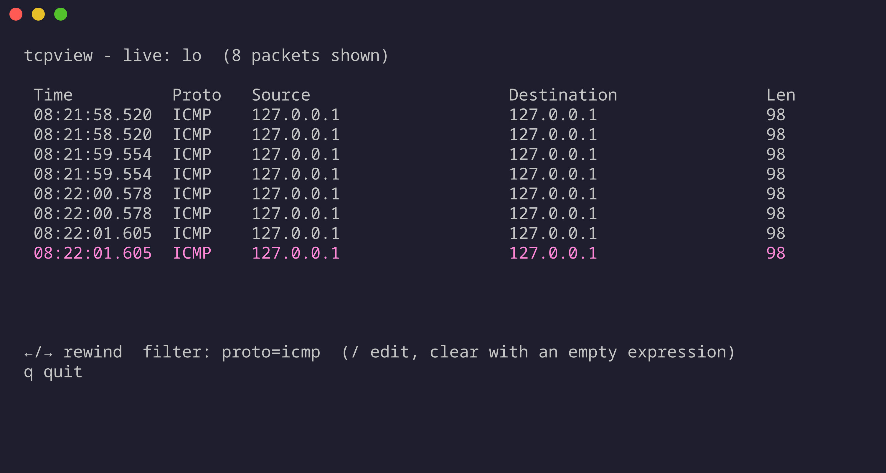
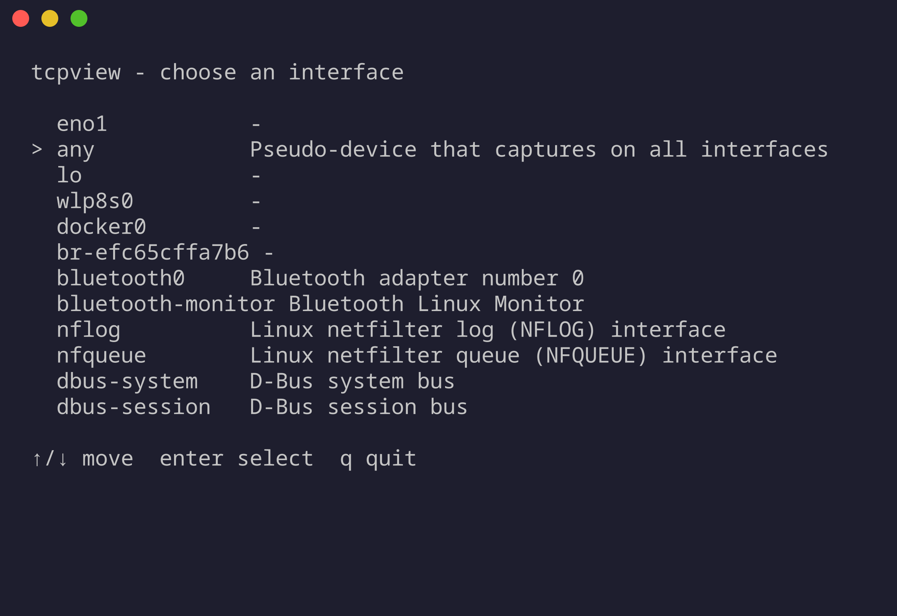
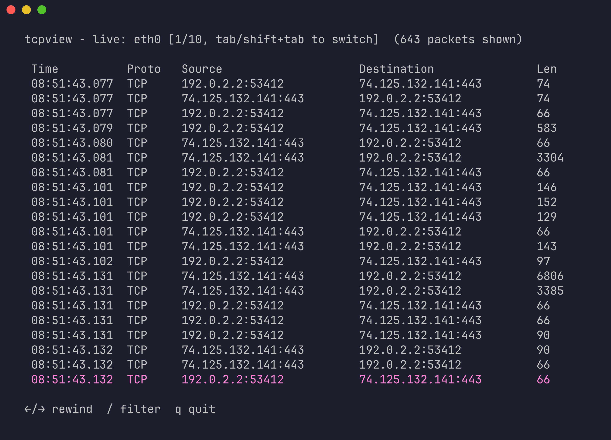
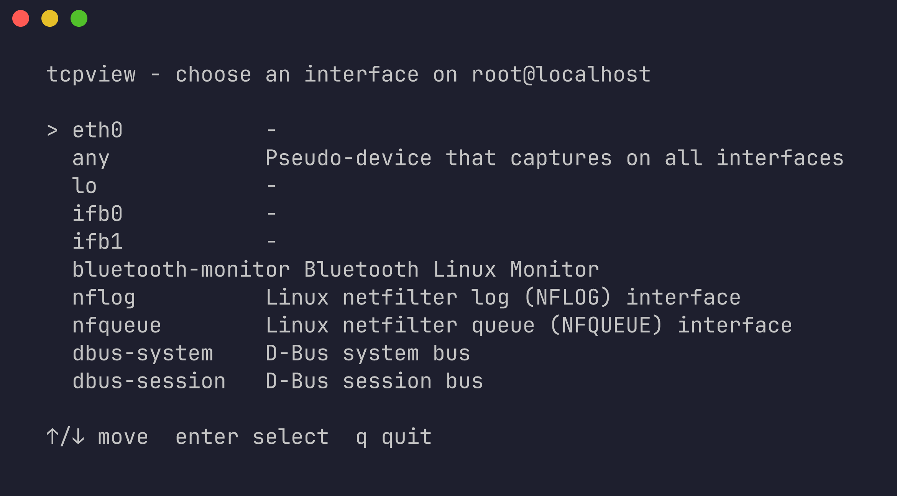
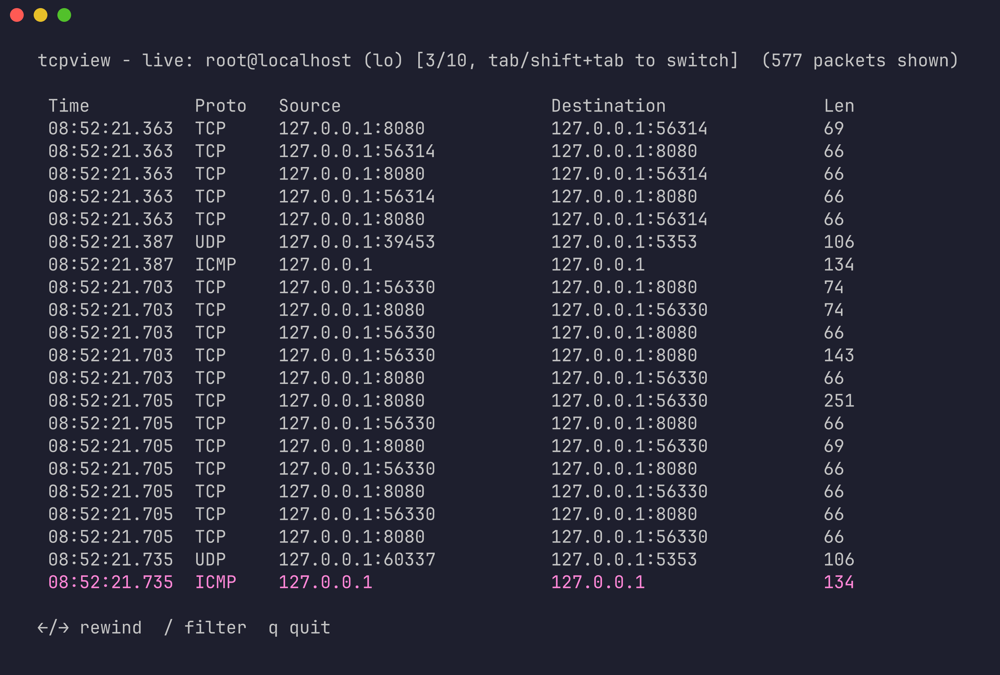
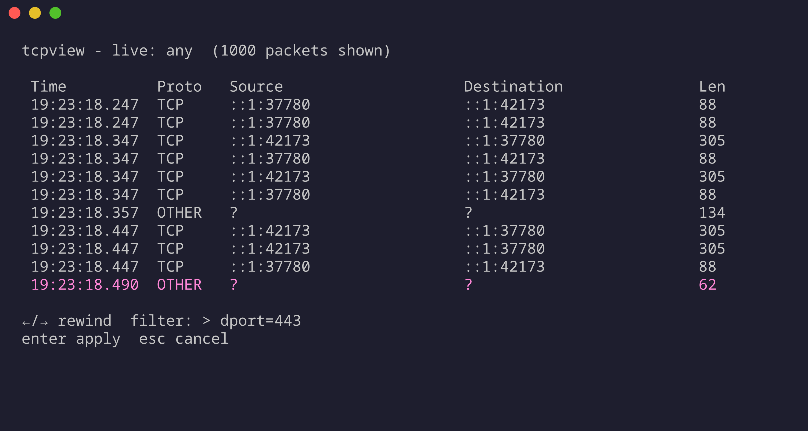
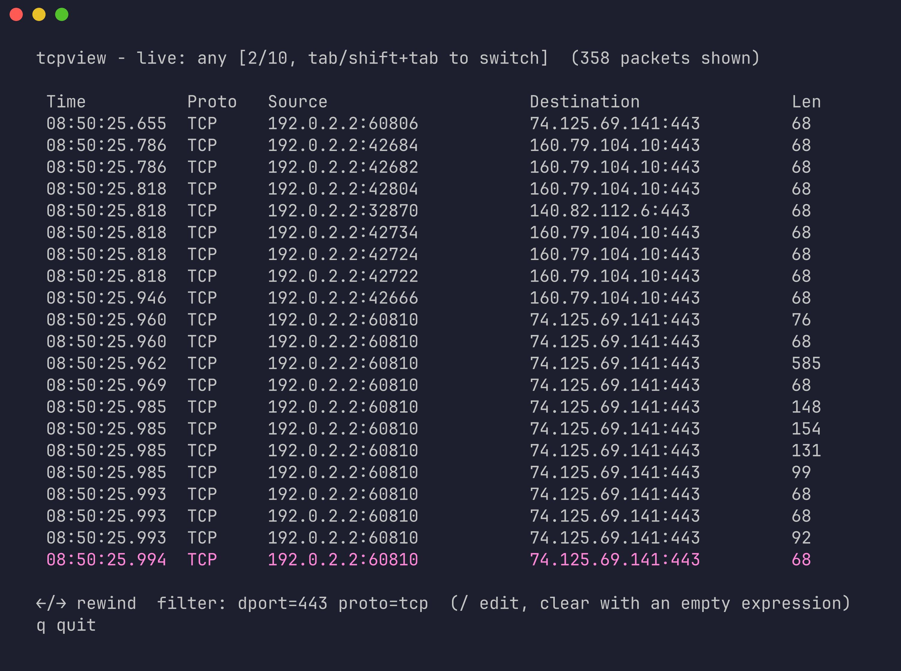
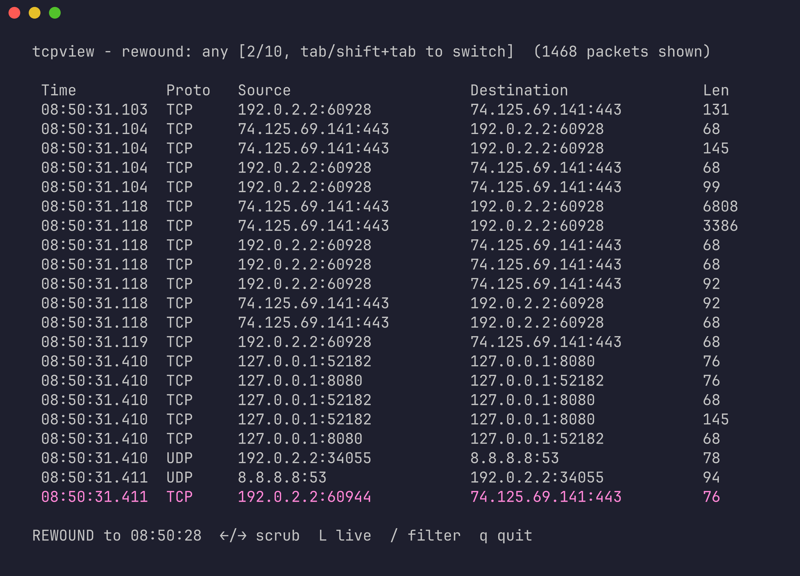
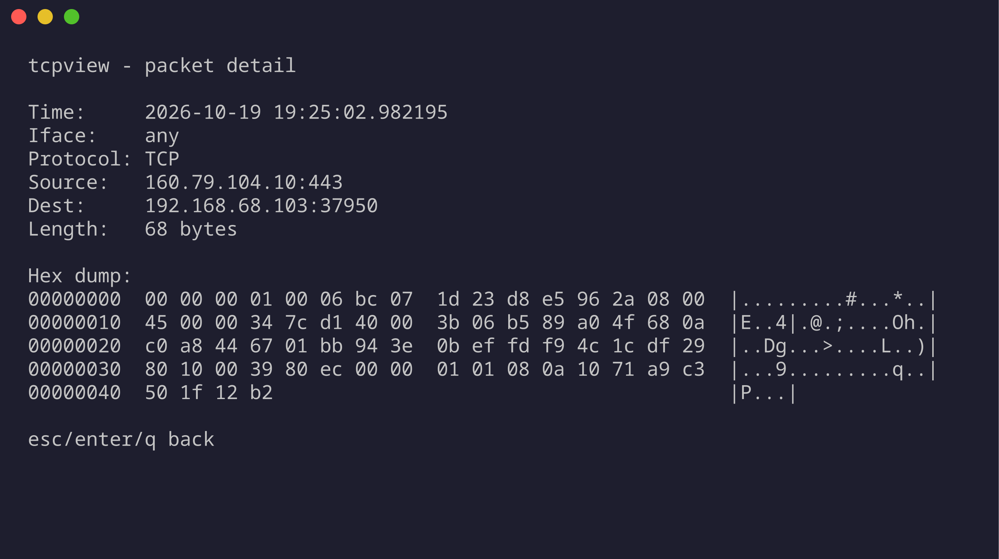
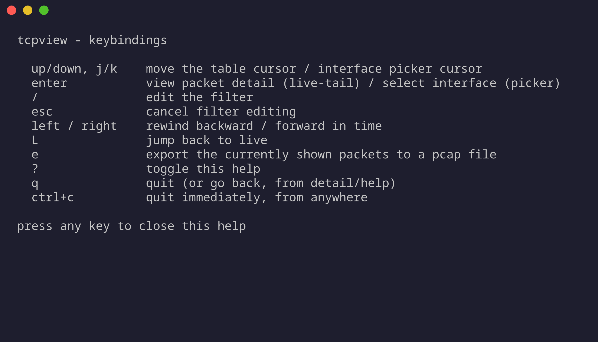

# tcpview

A terminal UI network traffic analyzer. No more remembering interface names, ports, or `tcpdump` filter syntax up front: pick an interface (or a remote host over SSH) from a list, watch decoded traffic live, filter it interactively, and rewind to see what already passed.

## Contents

- [Features](#features)
- [A tour, in screenshots](#a-tour-in-screenshots)
  - [No `tcpdump -D` required](#no-tcpdump--d-required)
  - [Flip through interfaces without restarting](#flip-through-interfaces-without-restarting)
  - [Remote hosts get the same picker](#remote-hosts-get-the-same-picker)
  - [Filtering is live, not a restart](#filtering-is-live-not-a-restart)
  - [Rewind: the actually novel part](#rewind-the-actually-novel-part)
  - [Packet detail, down to the bytes](#packet-detail-down-to-the-bytes)
  - [Full keybinding reference, always one keypress away](#full-keybinding-reference-always-one-keypress-away)
- [Installing a release binary](#installing-a-release-binary)
  - [Windows](#windows)
- [Building](#building)
- [Running](#running)
  - [Remote capture](#remote-capture)
  - [Keybindings](#keybindings)
  - [Rewind archive flags](#rewind-archive-flags)
  - [Config file](#config-file)
- [Development](#development)
  - [CI / releases](#ci--releases)
- [License](#license)



## Features

- **Live capture** on a local interface via libpcap, or on a **remote host over SSH** (`ssh <host> tcpdump -i <iface> -U -w -`, piped and decoded locally - no agent to install on the remote box, just SSH access and `tcpdump`). The SSH connection carrying the capture is filtered out of it automatically.
- **Live interface switching** - press `tab` / `shift+tab` mid-capture to cycle through interfaces without restarting, locally or on a remote host.
- **Interactive filtering** - press `/` and type a simple expression like `proto=tcp dport=443 src=10.0.0.0/24`, applied live against whatever's currently buffered.
- **Rewind** - press `←` to scrub backward through traffic that already scrolled off, `→` to scrub forward, `L` to jump back to live. Recent traffic is served from an in-memory ring; anything older comes from a bounded on-disk archive (see below).
- **Packet detail** - press `enter` on any row for a parsed field breakdown plus a hex+ASCII dump of the raw frame.
- **Export to pcapng** - press `e` to write whatever's currently shown (post-filter) to a real pcapng file, openable in Wireshark/tcpdump/etc, with each frame labeled with the link type it was actually captured with.
- **Help** - press `?` for a full keybinding reference at any time.

## A tour, in screenshots

Everything below is a real screenshot of real traffic captured on an actual machine while writing this - nothing staged or mocked.

### No `tcpdump -D` required

Launching with no arguments lists every capturable interface by name and description - including the real-but-easy-to-forget ones like `any` (capture on everything at once) alongside physical NICs, bridges, and `nflog`/`nfqueue`. Pick one with `↑`/`↓` + `enter`; no prior knowledge of interface names needed.



### Flip through interfaces without restarting

That first pick isn't final: once capturing, `tab` / `shift+tab` moves capture to the next / previous interface in the same list (wrapping at either end), so you can flip through every interface to see where traffic is actually flowing. The header always shows which one you're on. Here `shift+tab` has moved from the loopback capture above to `eth0`, where the only traffic is HTTPS out to the internet:



Each switch starts the view fresh for the new interface and keeps your active filter; with the on-disk archive enabled, the previous interface's buffered packets are archived rather than dropped, so rewind can still reach them (filter on `iface=` to tell them apart).

### Remote hosts get the same picker

`-remote user@host` on its own runs `tcpdump -D` on the host over SSH and lists *its* interfaces in the same picker (these two were taken over a real SSH session, to `localhost`):



From there it's the same UI, including `tab` / `shift+tab` to switch the remote capture between interfaces:



### Filtering is live, not a restart

Press `/` and type an expression - `iface`, `src`, `dst`, `sport`, `dport`, `proto` - while packets keep flowing in the background underneath it:



Hit `enter` and the view narrows instantly against the *existing* buffer - no re-capture, no dropped history. Here it's narrowed a noisy multi-protocol capture down to just the outbound HTTPS traffic, `dport=443 proto=tcp`:



### Rewind: the actually novel part

This is the feature a plain `tcpdump`/Wireshark live-capture session can't give you: scrub backward in time with `←`/`→` to see traffic that already scrolled off-screen, without having had to pre-emptively start a recording. Recent history comes from an in-memory ring; anything older is transparently pulled from a bounded on-disk archive that rotates and prunes itself (see [Rewind archive flags](#rewind-archive-flags) below) - the UI doesn't care which, it just shows you what was happening at that point in time, filters and all:



### Packet detail, down to the bytes

`enter` on any row in the live or rewound view opens a full breakdown plus a classic hex+ASCII dump of the actual captured frame - no separate tool needed to go one level deeper than the summary table:



### Full keybinding reference, always one keypress away

`?` from anywhere in the live view:



## Installing a release binary

```sh
curl -sSL https://raw.githubusercontent.com/jtrull101/tcpview/main/install.sh | sh
sudo tcpview
```

Detects your OS/arch, downloads the matching asset from the [latest release](https://github.com/jtrull101/tcpview/releases), and installs it to `/usr/local/bin/tcpview`, using `sudo` for that one copy if the directory isn't writable. `/usr/local/bin` is on `sudo`'s `secure_path`, which is why plain `sudo tcpview` works afterwards; a directory like `~/.local/bin` isn't, so `sudo` wouldn't find it there. Override with `INSTALL_DIR=/somewhere` (the script then tells you to run it by full path if `sudo` won't find it); pin a version with `VERSION=v0.1.0`. Both go before `sh` in the pipe, e.g. `curl ... | INSTALL_DIR=$HOME/.local/bin sh`. Prebuilt binaries cover linux/amd64, linux/arm64, darwin/amd64, darwin/arm64, and windows/amd64 (see [Windows](#windows) below; the script is for Linux and macOS). The script checks the download against the release's `SHA256SUMS` and refuses to install on a mismatch.

The Linux binaries link libpcap statically (a minimal build, see `.github/libpcap/build.sh`), so they run on any glibc distro regardless of which libpcap soname it ships. They leave out libpcap's Bluetooth, D-Bus, USB and RDMA capture backends, so those pseudo-interfaces don't appear in the picker; build from source (below) if you need them.

Releases before static linking were built against Ubuntu's legacy `libpcap.so.0.8` soname and fail to launch on distros that only ship `libpcap.so.1` (e.g. Arch). The install script detects that and prints the fix (`sudo ln -s /usr/lib/libpcap.so.1 /usr/lib/libpcap.so.0.8`).

### Windows

1. Install [Npcap](https://npcap.com/#download), the Windows packet capture driver. tcpview needs it for live capture but can't bundle it: Npcap's free license doesn't allow redistribution. Without it, tcpview exits with a message pointing here.
2. Download `tcpview-<version>-windows-amd64.zip` from the [latest release](https://github.com/jtrull101/tcpview/releases/latest), check it against the release's `SHA256SUMS` if you like (`Get-FileHash tcpview-*.zip` in PowerShell), and unzip it anywhere.
3. Run `tcpview.exe` in Windows Terminal or PowerShell.

Windows names adapters by device path (`\Device\NPF_{…}`), so the picker and header show each adapter's description instead ("Intel(R) Ethernet Connection …"). Capture runs as a normal user unless Npcap was installed with "Restrict Npcap driver's access to Administrators only", in which case run tcpview as Administrator. Remote capture (`-remote`) works with the OpenSSH client built into Windows 10 and later. The config file lives at `%AppData%\tcpview\config.json`.

## Building

```sh
go build -o tcpview .
# or: make build
```

Requires Go and `libpcap` (already installed on most Linux systems; `sudo pacman -S libpcap` on Arch).

A `Makefile` wraps the common dev commands:

```sh
make build         # go build -> ./tcpview
make run           # build + run (needs CAP_NET_RAW; see `make setcap`)
make setcap        # grant the built binary CAP_NET_RAW/CAP_NET_ADMIN once, so sudo isn't needed per-run
make test          # go test ./...
make test-race     # go test ./... -race
make cover         # race + coverage, prints the per-function/aggregate summary
make cover-check   # same, but fails if aggregate coverage drops below 90% or any package below its floor
make fuzz          # short fuzz smoke pass across every Fuzz target (FUZZTIME=10s by default)
make fmt           # gofmt -w .
make lint          # golangci-lint run ./...
make check         # everything CI runs: fmt-check, vet, lint, race tests, coverage gate
make clean         # remove build/coverage artifacts
make help          # list all targets
```

## Running

Live capture needs elevated privileges on Linux (`CAP_NET_RAW`), including under WSL2. Either:

```sh
sudo tcpview       # installed with install.sh
sudo ./tcpview     # built from source
```

or grant the capability once so you don't need `sudo` every time:

```sh
sudo setcap cap_net_raw,cap_net_admin=eip "$(command -v tcpview)"
tcpview
```

### Remote capture

```sh
./tcpview -remote user@host                    # pick from the remote host's interface list
./tcpview -remote user@host -remote-iface eth0 # start straight on eth0
```

Without `-remote-iface`, tcpview runs `tcpdump -D` on the remote host over SSH and shows the same interface picker as local capture, listing the *remote* host's interfaces. Either way, `tab` / `shift+tab` then switches the remote capture between those interfaces live. If listing fails (e.g. an old or restricted `tcpdump`), `-remote-iface` still works, just without switching; the live view says why.

Every remote interface (and every switch) is its own `ssh` session, so key-based auth is strongly recommended over password prompts. An SSH `ControlMaster`/`ControlPersist` config for the host makes switching near-instant by reusing one connection.

Requires SSH access to the host and `tcpdump` installed there (no root needed locally for this mode - the privilege requirement is on the remote end, where `tcpdump` runs). If you SSH in as a non-root user, pass the command to run instead, e.g. with passwordless sudo for tcpdump:

```sh
./tcpview -remote user@host -remote-tcpdump "sudo -n tcpdump"
```

The capture never includes its own SSH connection: tcpview asks the remote `tcpdump` to exclude it (from `$SSH_CONNECTION` on the remote side), so you don't see tcpview's own pcap stream, which would otherwise grow with every packet it forwards. Other SSH sessions to the host still show up as normal.

### Keybindings

| Key | Action |
|---|---|
| `↑`/`↓` or `j`/`k` | move the interface-picker cursor |
| `enter` | select an interface / apply a filter / view packet detail |
| `tab` / `shift+tab` | switch capture to the next / previous interface (local or remote) |
| `/` | edit the filter |
| `esc` | cancel filter editing |
| `←` / `→` | rewind backward / forward in time |
| `L` | jump back to live |
| `e` | export the currently shown (post-filter) packets to a pcapng file |
| `?` | toggle the full keybinding help screen |
| `q` | quit (editing a filter? just types a literal `q` instead; viewing detail/help? goes back) |
| `ctrl+c` | quit immediately, from anywhere |

### Rewind archive flags

```
-archive-dir string        directory for the on-disk rewind archive (default: a per-user cache dir)
-archive-cap-gib float     max total disk space, in GiB, the archive may use (default 1)
-no-archive                disable the on-disk archive entirely (rewind then limited to what's still in memory)
```

The archive rotates files by age/size and deletes the oldest ones first once the total exceeds the configured cap - it never grows unbounded.

### Config file

Flags above can also live in an optional JSON config file, checked by default at `$XDG_CONFIG_HOME/tcpview/config.json` (or `~/.config/tcpview/config.json`; `%AppData%\tcpview\config.json` on Windows), overridable with `-config path`:

```json
{
  "archive_dir": "/var/lib/tcpview/archive",
  "archive_cap_gib": 2.0,
  "no_archive": false
}
```

Precedence: an explicitly-passed CLI flag always wins over the config file, which always wins over the built-in default.

## Development

See `CLAUDE.md` for the testing policy (every package needs positive/negative/load/stress/chaos tests, >90% aggregate coverage, plus a per-package floor) and architecture notes (why the archive isn't literal pcap format, why remote capture shells out to the remote's own `tcpdump` instead of needing an agent, etc).

```sh
make check   # fmt-check, vet, golangci-lint, race-enabled tests, coverage gates - most of what CI runs
```

Every parser-like function (filter expressions, packet decoding, archive file parsing, remote `tcpdump -D` output, the `/proc/self/status` capability parser) also has a native Go fuzz test (`make fuzz` for a quick local smoke pass); CI runs a short fuzz pass on every push, and the project has been fuzzed for 5M+ executions locally with zero crashes found.

### CI / releases

- `.github/workflows/ci.yml` runs on every push/PR: build, `gofmt` check, `go vet`, `golangci-lint`, race-enabled tests, coverage gates (`scripts/coverage-gate.sh`: 90% aggregate, 85% per `internal/` package, 75% for the root package), `govulncheck`, and a fuzz smoke pass on Linux; race-enabled tests on macOS; tests on Windows (without real capture, since CI runners can't have Npcap); and the release's static-libpcap Linux build, so a break there shows up before a tag does.
- `.github/workflows/release.yml` runs on any `vX.Y.Z` tag push: builds native binaries for linux/amd64, linux/arm64, darwin/amd64, darwin/arm64, and windows/amd64, and publishes them as a GitHub Release with a `SHA256SUMS` file.
- `.github/dependabot.yml` opens weekly update PRs for Go modules and the Actions the workflows use.

## License

MIT - see [LICENSE](LICENSE).
